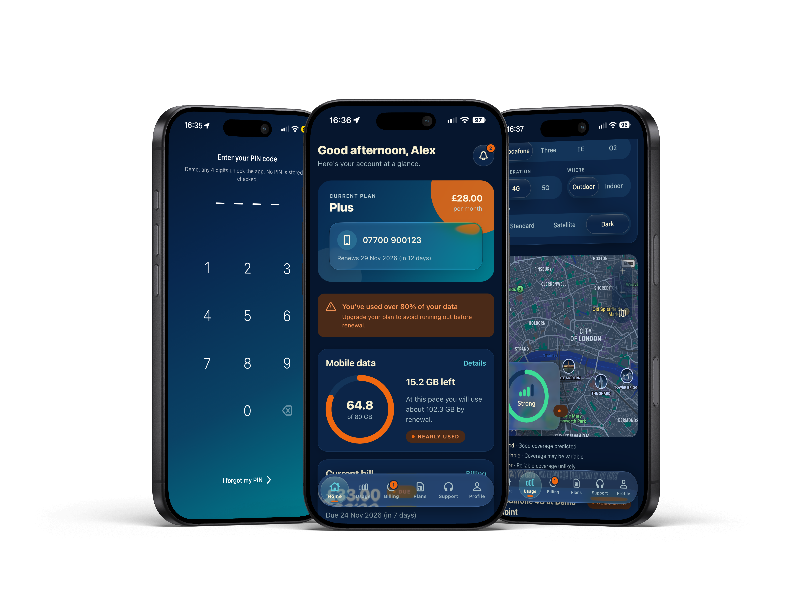
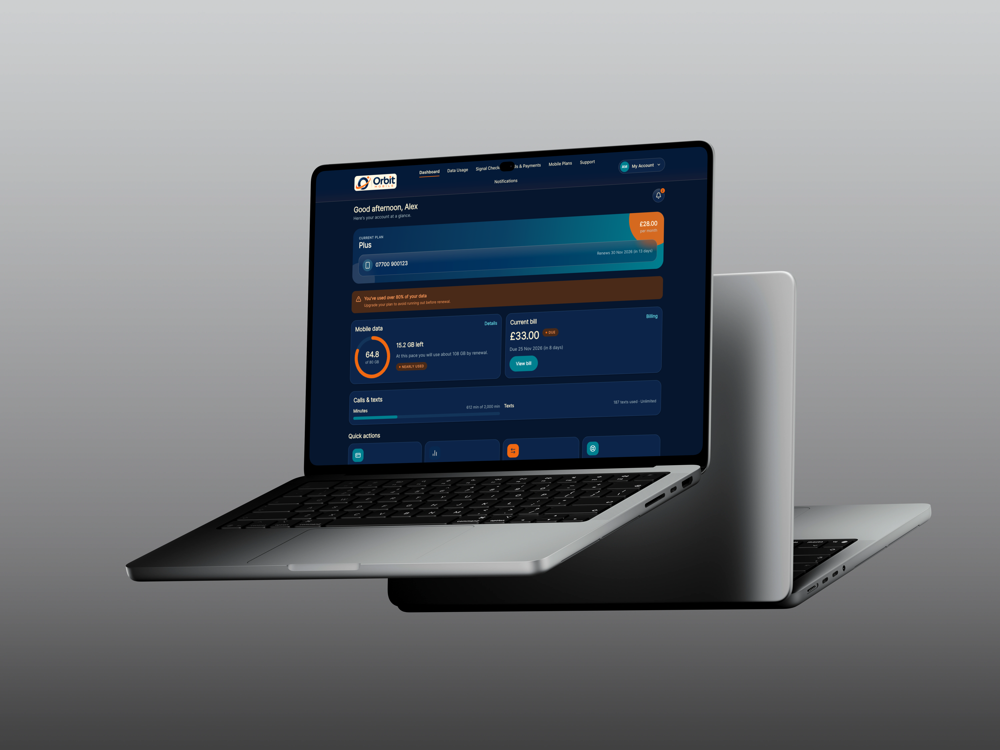

# Obrit Telecommunications

A modern telecommunications customer experience for mobile and web.

Obrit Telecommunications is an in-development customer self-service platform focused on helping mobile customers understand and manage their account, usage, bills, plan, support requests and predicted network coverage.

> **Project status: active development.** This README describes the product direction and the local development workflow. Not every feature listed is complete or connected to a production service, and **all account, billing, usage and support data in the app is demo data** (generated in-app, clearly labelled where it matters). The coverage feature can show real Ofcom predictions only once a valid Ofcom API key is configured; until then it runs in an explicitly labelled demo mode.

<p align="center">
  
</p>

## Application showcase

**Mobile application: iOS and Android.** PIN lock, account dashboard and the mobile coverage checker (demo data).

<p align="center">
  
</p>

**Web application: desktop dashboard.** The same account dashboard in the responsive web build.

<p align="center">
  
</p>

## Product overview

The experience is built with Expo / React Native for iOS, Android and web, with a small supporting coverage service. The visual identity uses deep navy, teal and orange accents with accessible, responsive interfaces.

### Customer experience

| Area | Scope | Status in this repository |
| --- | --- | --- |
| Account | Sign in, account overview and profile settings | Built against a **mock API** (public demo credentials; demo PIN lock on iOS/Android that accepts any 4 digits) |
| Mobile plan | Plan details, renewal information and plan management | Built against the mock API |
| Usage | Mobile data allowance, consumption indicators and alerts | Built against the mock API (animated charts) |
| Billing | Current bills, invoice history, due dates and payment status | Built against the mock API; payments are demo-only |
| Notifications | Usage warnings, billing updates and account alerts | Built; in-app and local device alerts only |
| Network coverage | UK postcode/location-based predicted coverage, network filters and a coverage-status display | Built (map, search, gauge, server). **Live Ofcom data not yet verified**; see below |
| Support | Help, contact and support journeys | Built against the mock API |

"Built against the mock API" means the screens work end to end, but nothing is connected to a production account, billing or support system.

## Brand

The Obrit identity includes an orbital O and wireless-signal motif. The intended app icon uses a navy background with teal/blue and orange highlights. Approved assets live in `assets/images/` and are referenced from `app.json`.

The app is **still branded "Orbit Mobile"** in its configuration (`name`, `slug`, `scheme` `orbit`, and the `com.example.orbitmobile` bundle identifiers) and in the UI. Renaming to Obrit, choosing real bundle identifiers and finalising the icon and splash screen are open roadmap items.

## Technology

- **Mobile and web:** Expo SDK 58, React Native, TypeScript (strict), Expo Router, Zustand, TanStack Query, React Hook Form and Zod.
- **Data layer:** each feature talks to a service interface that is either an in-app mock server (default) or an HTTP implementation. See [docs/API_CONTRACTS.md](docs/API_CONTRACTS.md). There is **no production backend or API gateway in this repository.**
- **Coverage service:** `server/` is a small Node/TypeScript service that holds the Ofcom credential, validates and caches responses and rate-limits requests. It shares its typed contracts with the app.
- **Mapping:** `react-native-maps` on iOS (Apple Maps) and Android (Google Maps); Leaflet on web. Geolocation uses `expo-location`; postcode geography comes from postcodes.io.
- **UK coverage data:** Ofcom's Connected Nations mobile coverage API. See [Ofcom API integration](#ofcom-api-integration) for its current status and a deadline.
- **Docker:** not used by this repository. (The separate `Telecom-Customer-Portal` repository has an optional Spring Boot + PostgreSQL compose setup for its web demo.)

## Getting started

### Requirements

- Node.js 22 and npm.
- Expo Go on an iOS/Android device, or a simulator/emulator, or just a browser.

### 1. Clone and install

```bash
git clone https://github.com/domwokorach/Obrit-Telecommunications.git
cd Obrit-Telecommunications
npm install
```

### 2. Start Expo

```bash
npx expo start --clear     # QR code for Expo Go; press i / a / w for simulator / emulator / web
```

Sign in with **Use demo account** (or `demo@orbit.example` / `Demo123!`; these are intentionally public demo credentials). On iOS and Android a PIN screen follows: **enter any 4 digits**; nothing is stored or checked. Expo Go shows the Expo Go icon on your home screen; Obrit's own home-screen icon needs a development or production build.

The app works with no backend at all: a mock API with simulated latency persists to local storage. **Profile → Settings → Demo tools** can simulate an outage and reset the data.

Port 8081 is often taken (Docker, Jenkins): use `npx expo start --port 8082`. Do not run the dev server with `CI=1`, which disables file watching.

### 3. Start the coverage service (optional)

```bash
npm run server                                                      # http://127.0.0.1:8787, demo mode without a key
EXPO_PUBLIC_COVERAGE_API_URL=http://localhost:8787 npx expo start   # point the app at it
```

Without `EXPO_PUBLIC_COVERAGE_API_URL` the app runs an in-app demo. Without `OFCOM_API_KEY` the server runs in demo mode. Both are labelled "Demo data" in the UI, and the app never presents generated values as live coverage. On a physical phone use your computer's LAN IP instead of `localhost` (Android emulator: `10.0.2.2`). Add your web dev origin to `CORS_ORIGINS` if it is not `localhost:8081` or `:19006`.

### 4. Check your work

```bash
npm run lint
npm run typecheck
npm test                 # app (Jest + React Native Testing Library)
npm run server:test      # coverage service (Node test runner, no network)
npm run export:web       # production web build in dist/
```

More detail (layout, per-platform notes, troubleshooting) is in the [development guide](docs/DEVELOPMENT.md).

## Environment configuration

Keep secrets in `server/.env` (git-ignored; copy `server/.env.example`). These are the variables the coverage service actually reads:

```bash
# Server-side only. Never prefix these with EXPO_PUBLIC_.
OFCOM_API_KEY=                 # Ofcom API subscription key; empty -> demo mode
COVERAGE_MODE=auto             # auto | live (requires the key) | demo
OFCOM_BASE_URL=https://api-proxy.ofcom.org.uk/mobile
PORT=8787
HOST=127.0.0.1
CORS_ORIGINS=http://localhost:8081,http://localhost:19006
```

The only coverage-related variable the app reads is `EXPO_PUBLIC_COVERAGE_API_URL`, **which is just the service's URL**. See `.env.example` and `server/src/config.ts` for cache, timeout and rate-limit settings.

Never commit API keys, passwords, signing secrets or customer information. Never expose a private API key through an `EXPO_PUBLIC_` variable: those values are embedded in the client app. (The production web bundle was checked and contains no server code or key.)

## Mobile coverage checker

Route: `/signal` (Usage screen → signal icon, or **Signal Checker** in the website header).

1. Search by UK postcode or town, use your location (permission asked only when you press the button), or tap the map.
2. Choose a network (Vodafone, Three, EE, O2), generation and indoor/outdoor.
3. View the provider-predicted coverage category, with the data source, dataset build and attribution.
4. Read the limitations shown on screen.

**Coverage is not measured signal strength.** The gauge shows the provider's category (Excellent / Strong / Moderate / Weak / No coverage) as a ring and signal bars, **with no percentage**, because Ofcom publishes categories and no validated numeric score. The map shows a single pin per postcode; it does not shade areas or draw circles around masts, because the data source provides no area geometry. Street-address search is not supported (postcode or town only).

Current limits worth knowing:

- **5G is shown as "Not provided".** Ofcom's current API returns no 5G or 2G values.
- The 4G figure is Ofcom's combined data value per operator (it includes 4G where available).
- Operator field mapping (`H3` = Three, `TF` = O2) is an **unconfirmed assumption**.
- iOS and Android map UI have been type-checked and unit-tested but **not run on a device**; the web UI has been exercised in a browser.

Details, architecture and the full verified / not-verified table: [docs/SIGNAL_CHECKER.md](docs/SIGNAL_CHECKER.md).

## Ofcom API integration

```
Expo mobile/web app
        |
        v
Coverage service (server/)  -- holds the key, validates, caches, rate-limits
        |
        v
Ofcom Connected Nations mobile coverage API
```

- **Current status:** the Ofcom Mobile Coverage (Basic) subscription request was submitted. **No live Ofcom call has been made from this code**, so live integration must not be claimed until a working key is verified. The adapter is built from Ofcom's published OpenAPI definition and tested only against responses shaped like it.
- **Deadline and risk:** Ofcom's API portal states that this legacy mobile API is **no longer accepting new subscriptions and will be decommissioned on 30 November 2026**. Confirm with Ofcom that the pending request is still valid and ask about the replacement 2G and 4G/5G APIs. Their schemas could not be read during development; moving to them means writing a new adapter in `server/src/` (the app, contracts and tests are shared).
- The provider API is called only from the coverage service, never directly from Expo.
- Follow the API's terms, attribution, disclosure and cache restrictions. Ofcom's copyright page allows reuse with acknowledgement and without misleading context; its API terms of use were not fully reviewed. Rate limits quoted in the docs (100 calls/minute, 50,000/month for Basic) come from a third-party client README, not Ofcom.
- Never invent coverage heatmap tiles or network measurements. Demo mode is the only place generated values exist, and it is labelled.

For more information, see [Ofcom](https://www.ofcom.org.uk/) and its [developer portal](https://api.ofcom.org.uk/).

## Development practices

- Keep mobile, web and backend configuration separate where platform needs differ.
- Validate request payloads and authenticate protected backend routes.
- Use typed contracts between client and API services (the coverage contracts are one zod file shared by app and server).
- Provide loading, empty, offline, error and permission-denied states.
- Build accessible components with clear labels and sufficient contrast; respect reduced motion.
- Add unit and integration tests as features are implemented. CI runs lint, typecheck, app tests, coverage-service tests and a web export.
- Use environment-specific credentials and configuration; never depend on the demo credentials or demo PIN for real customer authentication.

## Roadmap

- [x] Verify the repository structure and document exact run/test commands.
- [ ] Rename the app configuration from Orbit to Obrit; choose real bundle identifiers.
- [ ] Finalise Obrit branding, splash screen and custom installed-app icon.
- [ ] Integrate account authentication securely with a real backend (today: mock API, demo PIN).
- [ ] Connect dashboard, plan, usage, billing and notification views to verified API data.
- [ ] Obtain a working Ofcom key, verify live responses, and migrate to Ofcom's replacement APIs before 30 November 2026 (this also unlocks real 5G, if supplied).
- [ ] Run the signal checker on real iOS and Android devices; add a Google Maps key for Android store builds.
- [ ] Choose a production map-tile provider and disclose third-party tile requests in the cookie policy.
- [ ] Improve monitoring, accessibility, automated testing and deployment configuration.

The roadmap is a planning checklist, not a record of work already completed.

## Security and privacy

This project may handle sensitive account, billing and location information. Use least-privilege access, strong secrets, encrypted network transport, appropriate retention practices and explicit location permissions. Never publish credentials, raw customer data or production exports in a public repository.

Specific to the current code: the demo PIN is a mock and protects nothing; location is requested once, only when the user presses **Use my location**, and is sent only to the coverage service to find the nearest postcode; on the web, map tiles are fetched directly by the visitor's browser from OpenStreetMap and Esri.

## Disclaimer

Obrit Telecommunications is a software project under development. Unless separately established, it should not be represented as a licensed mobile network operator, an Ofcom-endorsed service or an affiliate of Vodafone, Three, EE or O2. Network coverage is estimated and may differ from reception on a specific device.

## Contributing and licence

Open an issue to discuss significant changes before submitting a pull request.

**Licence: needs your decision.** The repository currently contains a `LICENSE` file that is the Expo project template's MIT notice (copyright "650 Industries, Inc. (aka Expo)"), not a licence chosen for Obrit. Replace it with the terms you intend, or remove it, before the project is shared or published; until then, no Obrit-specific licence should be assumed.
