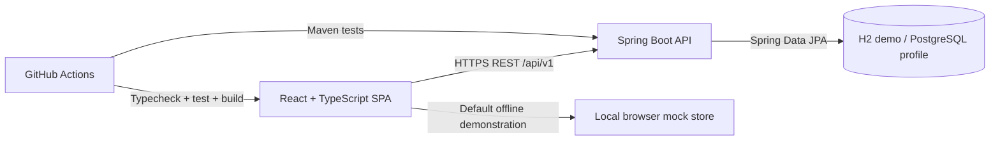

# Architecture and engineering decisions

## System context



- `frontend`: React 19, TypeScript, Vite, hand-built component styling, Vitest tests.
- `backend`: Java 21, Spring Boot, Spring Security HTTP Basic **demo-only**, Bean Validation, Spring Data JPA.
- `VITE_API_MODE=mock`: local-storage backed fictional data. No server, credentials, network, or payment processing.
- `VITE_API_MODE=server`: React calls the `/api/v1` endpoint; Vite proxies to Spring Boot on `localhost:8080`.
- Persistence: H2 in-memory by default. Optional PostgreSQL via Docker Compose/profile.

## API contract

| Method | Route | Purpose | Response |
| --- | --- | --- | --- |
| GET | `/api/v1/portal` | Aggregated account dashboard | `PortalDto` |
| PATCH | `/api/v1/plan` | Select a validated sample plan | `PortalDto` |
| POST | `/api/v1/tickets` | Create a validated support ticket | `PortalDto` |
| PATCH | `/api/v1/profile` | Update name and email | `PortalDto` |
| POST | `/api/v1/demo/reset` | Reset sample data | `PortalDto` |

Every API route requires HTTP Basic in *server mode*; demo credentials are `demo` / `Demo123!`. This is **not production-grade auth**. A production version should integrate an OIDC provider, user-specific authorization, secrets management, rate limiting, and CSRF policies appropriate to the chosen session strategy.

### Example request

```sh
curl -u demo:Demo123\! http://localhost:8080/api/v1/portal
curl -u demo:Demo123\! -X PATCH http://localhost:8080/api/v1/plan \
  -H 'Content-Type: application/json' -d '{"planId":"unlimited"}'
```

### Example JSON payloads

```json
{"planId":"essential"}
```

```json
{"subject":"eSIM assistance","message":"I need help activating my eSIM.","category":"Technical support"}
```

## Key engineering trade-offs

**Aggregated API:** A single snapshot endpoint reduces round-trips on dashboard load and keeps the UI simple. In a larger platform, read-focused composition could move into a backend-for-frontend with cacheability, partial rendering, ETags, and service-level boundaries.

**Mock-mode dependency isolation:** The UI relies on a typed `portalApi` abstraction rather than importing demo state into page components. This permits UI development without backend availability. Mock mode is default for simple recruiter review.

**Database choices:** H2 is disposable and zero-configuration; PostgreSQL demonstrates a relational deployment profile. `ddl-auto=update` in the PostgreSQL demo is **not appropriate for production**—replace with Flyway or Liquibase migrations. Production would also need managed backups, resilience and per-customer relationships.

**Simplified domain model:** One seeded fictional customer is intentional. No real SIM activation, charging, card payments or telecom network services are integrated. For multi-tenant production use, scope every query and mutation to authenticated customer IDs and add authorization tests.

**Charts and CSS:** CSS-rendered charts and a native conic gradient avoid additional runtime chart dependencies and reduce bundle weight. The ring has an `aria-label`, and chart values are also represented in a structured dataset. For larger analytics, a responsive charting library with keyboard-accessible data tables would be preferable.

**Plan changes:** Requiring explicit confirmation avoids accidental mutations. The backend validates selected plan IDs. For real money, use a pricing/entitlement service, an audit trail, transaction coordination and idempotency keys.

## Accessibility and UX

- Semantic landmarks (`header`, `nav`, `main`, `footer`), focus-visible outlines and native forms.
- Form labels, browser validation, live status notifications, responsive layouts and reduced-motion support.
- Native data tables for invoices, descriptive button labels and labelled usage ring.
- Future improvement: focus-trap and focus restoration for plan-change dialog, screen-reader audit, automated axe checks, contrast audit and 200% zoom testing.

## Testing and observability roadmap

Current repository includes Vitest tests for mock state and formatting, and Spring Boot MVC tests covering authorization, response shape and invalid requests. GitHub Actions has build, typecheck and test jobs. Tests were authored for the repository, but dependencies were unavailable in the authoring environment, so do **not** claim they passed until CI runs.

Suggested production enhancements: Playwright browser tests, MSW contract tests, OpenAPI-based client generation, Testcontainers/PostgreSQL integration tests, structured logs with correlation IDs, tracing through OpenTelemetry, RED metrics, error budgets, Lighthouse CI, dependency scanning, SAST and security review.
